# Домашнее задание к занятию 5. «Практическое применение Docker» — Чеботников М.Б.

### Инструкция к выполнению

1. Для выполнения заданий обязательно ознакомьтесь с [инструкцией](https://github.com/netology-code/devops-materials/blob/master/cloudwork.MD) по экономии облачных ресурсов. Это нужно, чтобы не расходовать средства, полученные в результате использования промокода.
3. **Своё решение к задачам оформите в вашем GitHub репозитории.**
4. В личном кабинете отправьте на проверку ссылку на .md-файл в вашем репозитории.
5. Сопроводите ответ необходимыми скриншотами.

---
## Примечание: Ознакомьтесь со схемой виртуального стенда [по ссылке](https://github.com/netology-code/shvirtd-example-python/blob/main/schema.pdf)

---

> **Мой fork:** https://github.com/makscebotnikov-cmd/shvirtd-example-python (fork от `netology-code/shvirtd-example-python`)
>
> Существующие файлы проекта не изменялись. Добавлены ровно 5 файлов:
> [`Dockerfile.python`](https://github.com/makscebotnikov-cmd/shvirtd-example-python/blob/main/Dockerfile.python),
> [`compose.yaml`](https://github.com/makscebotnikov-cmd/shvirtd-example-python/blob/main/compose.yaml),
> [`.gitignore`](https://github.com/makscebotnikov-cmd/shvirtd-example-python/blob/main/.gitignore),
> [`.dockerignore`](https://github.com/makscebotnikov-cmd/shvirtd-example-python/blob/main/.dockerignore),
> bash-скрипт [`deploy.sh`](https://github.com/makscebotnikov-cmd/shvirtd-example-python/blob/main/deploy.sh).

---

## Задача 0
1. Убедитесь что у вас НЕ(!) установлен ```docker-compose```, для этого получите следующую ошибку от команды ```docker-compose --version```
```
Command 'docker-compose' not found, but can be installed with:

sudo snap install docker          # version 24.0.5, or
sudo apt  install docker-compose  # version 1.25.0-1

See 'snap info docker' for additional versions.
```
В случае наличия установленного в системе ```docker-compose``` - удалите его.  
2. Убедитесь что у вас УСТАНОВЛЕН ```docker compose```(без тире) версии не менее v2.24.X, для это выполните команду ```docker compose version```  

---

## Задача 1
1. Сделайте в своем GitHub пространстве fork [репозитория](https://github.com/netology-code/shvirtd-example-python).

2. Создайте файл ```Dockerfile.python``` на основе существующего `Dockerfile`:
   - Используйте базовый образ ```python:3.12-slim```
   - Обязательно используйте конструкцию ```COPY . .``` в Dockerfile
   - Создайте `.dockerignore` файл для исключения ненужных файлов
   - Используйте ```CMD ["uvicorn", "main:app", "--host", "0.0.0.0", "--port", "5000"]``` для запуска
   - Протестируйте корректность сборки
2.1 Используйте multistage сборку вместо single stage.
3. (Необязательная часть, *) Изучите инструкцию в проекте и запустите web-приложение без использования docker, с помощью venv. (Mysql БД можно запустить в docker run).
4. (Необязательная часть, *) Изучите код приложения и добавьте управление названием таблицы через ENV переменную.
---
### ВНИМАНИЕ!
!!! В процессе последующего выполнения ДЗ НЕ изменяйте содержимое файлов в fork-репозитории! Ваша задача ДОБАВИТЬ 5 файлов: ```Dockerfile.python```, ```compose.yaml```, ```.gitignore```, ```.dockerignore```,```bash-скрипт```. Если вам понадобилось внести иные изменения в проект - вы что-то делаете неверно!

---

## Ответ

Fork: https://github.com/makscebotnikov-cmd/shvirtd-example-python

`Dockerfile.python` — multistage-сборка: в первой стадии (`builder`) в отдельный venv `/opt/venv` ставятся зависимости из `requirements.txt`, во вторую стадию копируется только готовый venv и код (`COPY . .`), без кэша pip. Лишнее (`.git`, `.env`, документация, конфиги прокси, compose-файлы) отсекается `.dockerignore`.

```dockerfile
FROM python:3.12-slim AS builder
WORKDIR /app
RUN python -m venv /opt/venv
ENV PATH="/opt/venv/bin:$PATH"
COPY requirements.txt .
RUN pip install --no-cache-dir -r requirements.txt

FROM python:3.12-slim
WORKDIR /app
COPY --from=builder /opt/venv /opt/venv
ENV PATH="/opt/venv/bin:$PATH" PYTHONDONTWRITEBYTECODE=1 PYTHONUNBUFFERED=1
COPY . .
CMD ["uvicorn", "main:app", "--host", "0.0.0.0", "--port", "5000"]
```

Клонирование своего fork и содержимое `Dockerfile.python`:

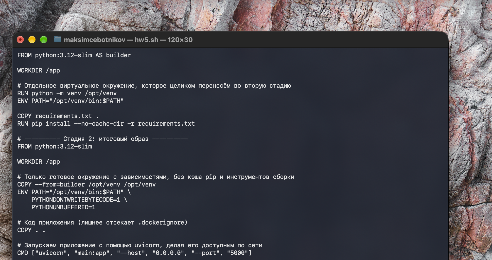

Проверка сборки `docker build -f Dockerfile.python -t shvirtd-web:local .` — видны обе стадии (`builder` и `stage-1`):

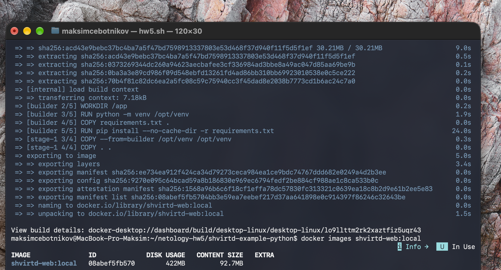

---

## Задача 2 (*)
1. Создайте в yandex cloud container registry с именем "test" с помощью "yc tool" . [Инструкция](https://cloud.yandex.ru/ru/docs/container-registry/quickstart/?from=int-console-help)
2. Настройте аутентификацию вашего локального docker в yandex container registry.
3. Соберите и залейте в него образ с python приложением из задания №1.
4. Просканируйте образ на уязвимости.
5. В качестве ответа приложите отчет сканирования.
---

## Ответ

Задание необязательное (*), не выполнялось.

---

## Задача 3
1. Изучите файл "proxy.yaml"
2. Создайте в репозитории с проектом файл ```compose.yaml```. С помощью директивы "include" подключите к нему файл "proxy.yaml".
3. Опишите в файле ```compose.yaml``` следующие сервисы: 

- ```web```. Образ приложения должен ИЛИ собираться при запуске compose из файла ```Dockerfile.python``` ИЛИ скачиваться из yandex cloud container registry(из задание №2 со *). Контейнер должен работать в bridge-сети с названием ```backend``` и иметь фиксированный ipv4-адрес ```172.20.0.5```. Сервис должен всегда перезапускаться в случае ошибок.
Передайте необходимые ENV-переменные для подключения к Mysql базе данных по сетевому имени сервиса ```web``` 

- ```db```. image=mysql:8. Контейнер должен работать в bridge-сети с названием ```backend``` и иметь фиксированный ipv4-адрес ```172.20.0.10```. Явно перезапуск сервиса в случае ошибок. Передайте необходимые ENV-переменные для создания: пароля root пользователя, создания базы данных, пользователя и пароля для web-приложения.Обязательно используйте уже существующий .env file для назначения секретных ENV-переменных!

2. Запустите проект локально с помощью docker compose , добейтесь его стабильной работы: команда ```curl -L http://127.0.0.1:8090``` должна возвращать в качестве ответа время и локальный IP-адрес. Если сервисы не стартуют воспользуйтесь командами: ```docker ps -a ``` и ```docker logs <container_name>``` . Если вместо IP-адреса вы получаете информационную ошибку --убедитесь, что вы шлете запрос на порт ```8090```, а не 5000.

5. Подключитесь к БД mysql с помощью команды ```docker exec -ti <имя_контейнера> mysql -uroot -p<пароль root-пользователя>```(обратите внимание что между ключем -u и логином root нет пробела. это важно!!! тоже самое с паролем) . Введите последовательно команды (не забываем в конце символ ; ): ```show databases; use <имя вашей базы данных(по-умолчанию virtd, как это указано в .env)>; show tables; SELECT * from requests LIMIT 10;```. Примечание: таблица в БД создается после первого поступившего запроса к приложению.

6. Остановите проект. В качестве ответа приложите скриншот sql-запроса.

---

## Ответ

[`compose.yaml`](https://github.com/makscebotnikov-cmd/shvirtd-example-python/blob/main/compose.yaml) в моём fork:

```yaml
include:
  - proxy.yaml   # reverse-proxy (haproxy), ingress-proxy (nginx) и сеть backend 172.20.0.0/24

services:
  db:
    image: mysql:8
    restart: on-failure
    env_file:
      - .env   # MYSQL_ROOT_PASSWORD, MYSQL_DATABASE, MYSQL_USER, MYSQL_PASSWORD
    networks:
      backend:
        ipv4_address: 172.20.0.10
    healthcheck:
      test: ["CMD-SHELL", "mysqladmin ping -h 127.0.0.1 -uroot -p$$MYSQL_ROOT_PASSWORD --silent"]
      interval: 5s
      timeout: 5s
      retries: 20

  web:
    build:
      context: .
      dockerfile: Dockerfile.python
    restart: always
    environment:
      DB_HOST: db
      DB_USER: ${MYSQL_USER}
      DB_PASSWORD: ${MYSQL_PASSWORD}
      DB_NAME: ${MYSQL_DATABASE}
    networks:
      backend:
        ipv4_address: 172.20.0.5
    depends_on:
      db:
        condition: service_healthy
```

- `web` собирается из `Dockerfile.python`, сеть `backend`, адрес `172.20.0.5`, `restart: always`; к БД подключается по сетевому имени сервиса `db`, логин/пароль/имя БД берутся из существующего `.env`.
- `db` — `mysql:8`, сеть `backend`, адрес `172.20.0.10`, `restart: on-failure`; root-пароль, база, пользователь и пароль приложения — из `.env` (`env_file`). Healthcheck нужен, чтобы `web` стартовал только после готовности MySQL.
- Сеть `backend` (bridge, 172.20.0.0/24) объявлена в `proxy.yaml` и подключается через `include`.

Запуск проекта (`docker compose up -d --build`), все 4 контейнера работают, `db` — healthy:

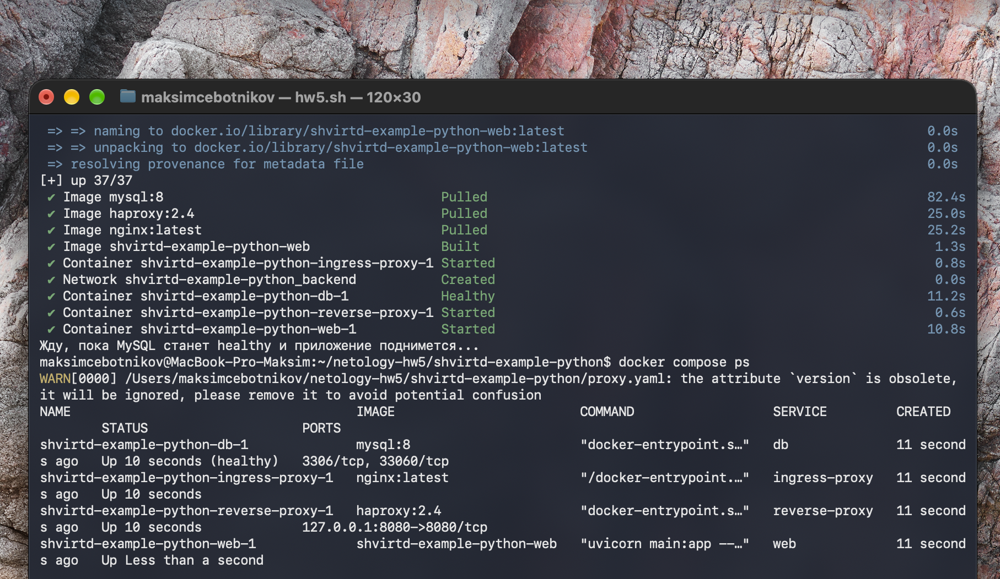

`curl -L http://127.0.0.1:8090` возвращает время и IP:

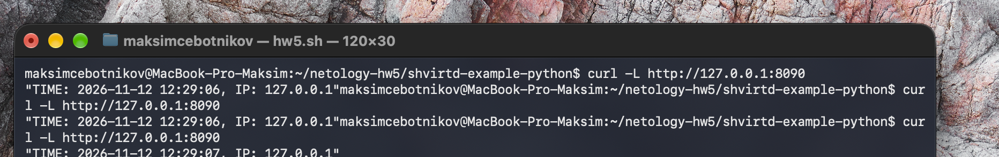

SQL-запрос `show databases; use virtd; show tables; SELECT * from requests LIMIT 10;`:

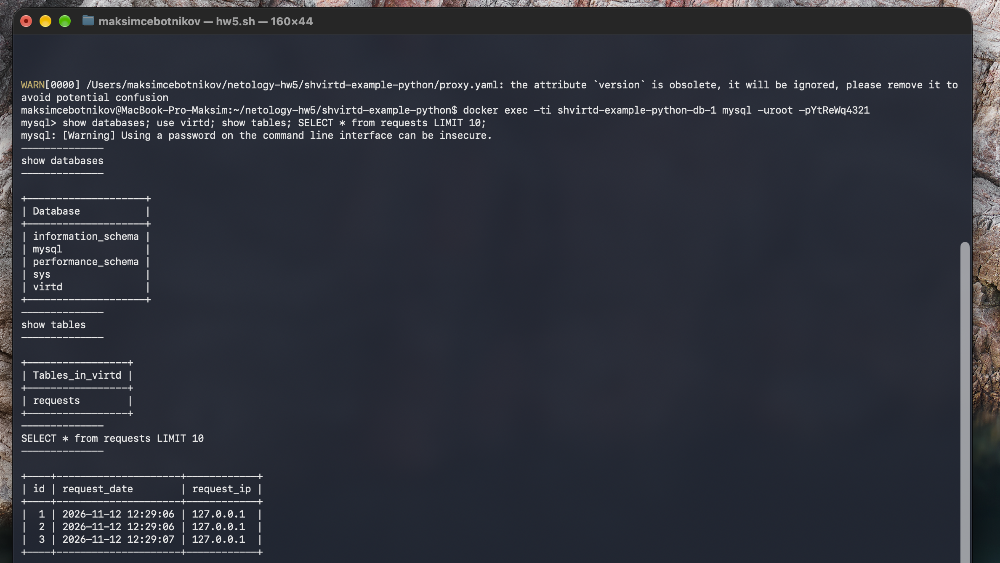

Остановка проекта:

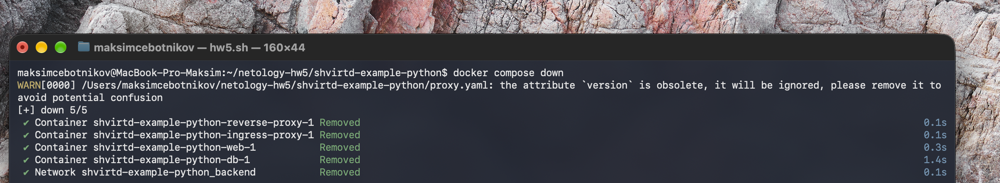

---

## Задача 4
1. Запустите в Yandex Cloud ВМ (вам хватит 2 Гб Ram).
2. Подключитесь к Вм по ssh и установите docker.
3. Напишите bash-скрипт, который скачает ваш fork-репозиторий в каталог /opt и запустит проект целиком.
4. Зайдите на сайт проверки http подключений, например(или аналогичный): ```https://check-host.net/check-http``` и запустите проверку вашего сервиса ```http://<внешний_IP-адрес_вашей_ВМ>:8090```. Таким образом трафик будет направлен в ingress-proxy. Трафик должен пройти через цепочки: Пользователь → Internet → Nginx → HAProxy → FastAPI(запись в БД) → HAProxy → Nginx → Internet → Пользователь
5. (Необязательная часть) Дополнительно настройте remote ssh context к вашему серверу. Отобразите список контекстов и результат удаленного выполнения ```docker ps -a```
6. Повторите SQL-запрос на сервере и приложите скриншот и ссылку на fork.
---

## Ответ

**Fork:** https://github.com/makscebotnikov-cmd/shvirtd-example-python

**Скрипт:** [`deploy.sh`](https://github.com/makscebotnikov-cmd/shvirtd-example-python/blob/main/deploy.sh) — клонирует **мой fork** в `/opt/shvirtd-example-python` (или обновляет его, если он уже есть) и запускает проект целиком:

```bash
#!/bin/bash
# Разворачивает проект из МОЕГО форка в /opt и запускает его целиком.
# Использование:  sudo bash deploy.sh
set -euo pipefail

REPO_URL="https://github.com/makscebotnikov-cmd/shvirtd-example-python.git"
TARGET_DIR="/opt/shvirtd-example-python"

if [ -d "$TARGET_DIR/.git" ]; then
  echo ">>> Репозиторий уже есть, обновляю: $TARGET_DIR"
  git -C "$TARGET_DIR" pull --ff-only
else
  echo ">>> Клонирую $REPO_URL в $TARGET_DIR"
  git clone "$REPO_URL" "$TARGET_DIR"
fi

cd "$TARGET_DIR"
echo ">>> Запускаю проект"
docker compose up -d --build

echo ">>> Состояние контейнеров"
docker compose ps
```

ВМ в Yandex Cloud (`netology-hw5`, Ubuntu 24.04, 2 vCPU 20%, 2 ГБ RAM, прерываемая), подключение по ssh и установка Docker:

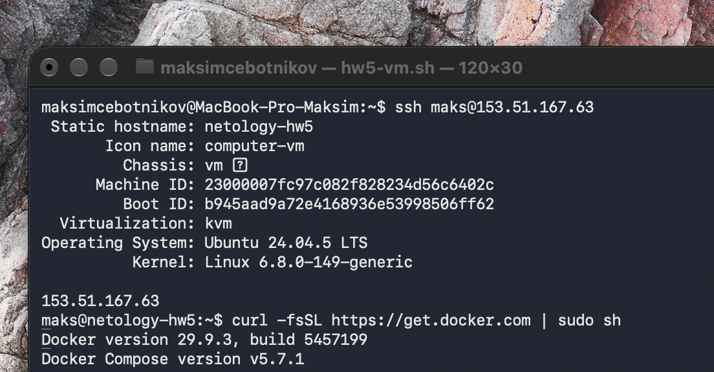

Скрипт скачан на ВМ прямо из моего fork:

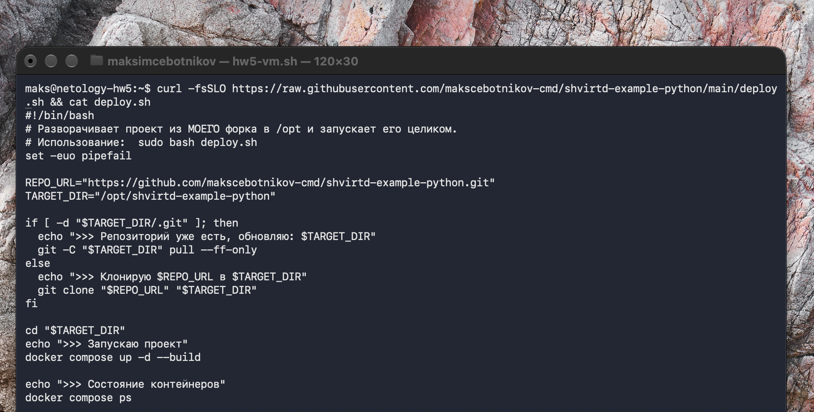

После `sudo bash deploy.sh`: в `/opt/shvirtd-example-python` лежит клон **моего** fork (`git remote -v`, последние коммиты — добавленные мной файлы), все контейнеры работают, приложение отвечает:

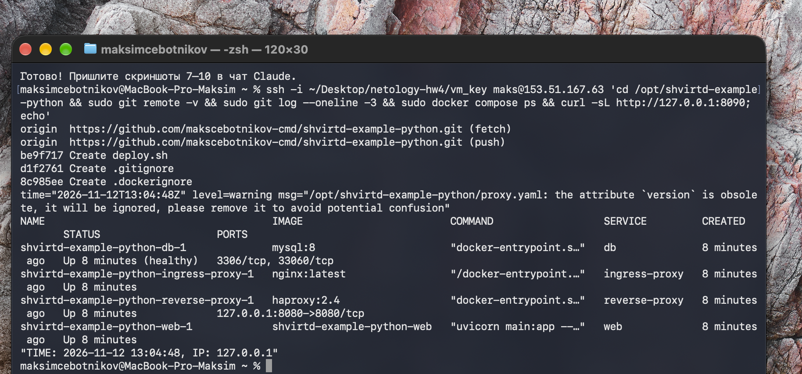

Проверка `http://153.51.167.63:8090` через check-host.net — ответ 200 OK из разных стран:

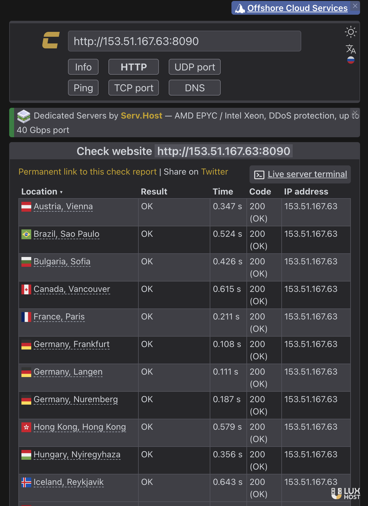

SQL-запрос на сервере — в таблице `requests` видны внешние IP узлов check-host (запросы прошли по цепочке Internet → Nginx → HAProxy → FastAPI → MySQL):

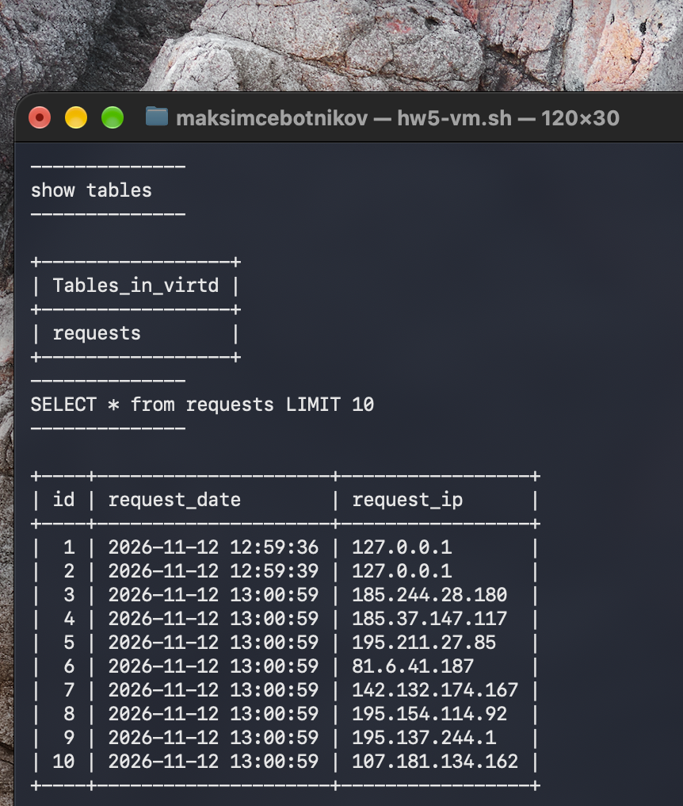

---

## Задача 5 (*)
1. Напишите и задеплойте на вашу облачную ВМ bash скрипт, который произведет резервное копирование БД mysql в директорию "/opt/backup" с помощью запуска в сети "backend" контейнера из образа ```schnitzler/mysqldump``` при помощи ```docker run ...``` команды. Подсказка: "документация образа."
2. Протестируйте ручной запуск
3. Настройте выполнение скрипта раз в 1 минуту через cron, crontab или systemctl timer. Придумайте способ не светить логин/пароль в git!!
4. Предоставьте скрипт, cron-task и скриншот с несколькими резервными копиями в "/opt/backup"

## Задача 6
Скачайте docker образ ```hashicorp/terraform:latest``` и скопируйте бинарный файл ```/bin/terraform``` на свою локальную машину, используя dive и docker save.
Предоставьте скриншоты  действий .
---

## Ответ

Скачиваю образ `hashicorp/terraform:latest`:

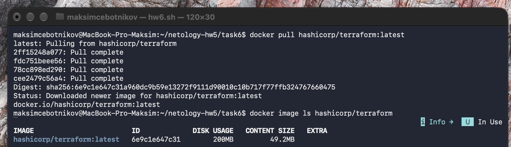

В `dive` видно, что бинарник добавляется последним слоем `COPY dist/linux/arm64/terraform /bin/terraform` (119 MB), в дереве файлов этого слоя — `/bin/terraform`:

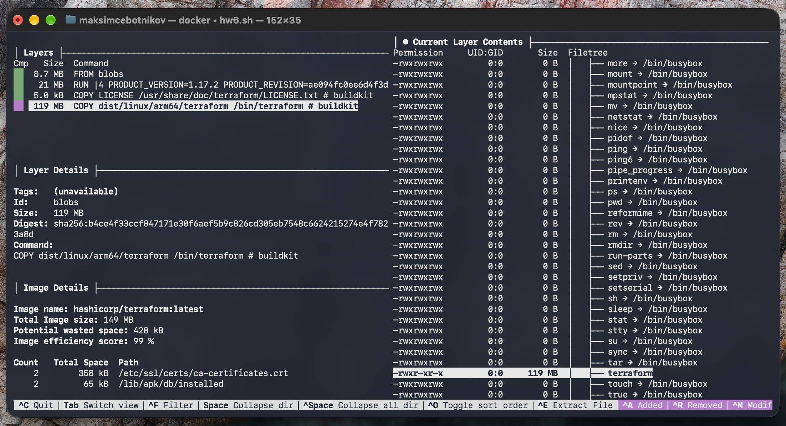

Сохраняю образ через `docker save` в tar-архив (формат OCI: `blobs/`, `index.json`, `manifest.json`), нахожу слой, содержащий `bin/terraform`, и извлекаю из него бинарник на локальную машину. `file` подтверждает, что это исполняемый файл terraform (ELF 64-bit, Go; образ для arm64, т.к. работаю на Mac с Apple Silicon):

```bash
docker save hashicorp/terraform:latest -o terraform.tar
mkdir image && tar -xf terraform.tar -C image
# слой, где лежит bin/terraform
for f in $(find image -type f -size +1M); do tar -tf "$f" | grep -qx 'bin/terraform' && LAYER=$f; done
tar -xf $LAYER -C . bin/terraform && cp bin/terraform ./terraform
ls -lh ./terraform && file ./terraform
```

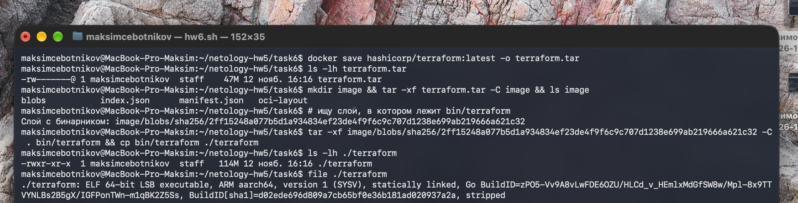
